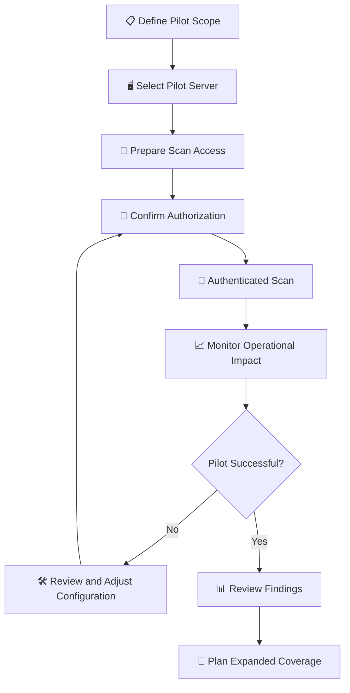

# 🔎 Initial Vulnerability Scan | Server Team Meeting

### 🌿🐇 Juniper Rabbit Labs

> **Meeting:** Initial Vulnerability Scan — Server Team Coordination  
> **Scenario:** Planning the Initial Authenticated Vulnerability Scan  
> **Format:** Simulated stakeholder meeting transcript  
> **Environment:** Juniper Rabbit Labs  
> **Role:** Katy — Vulnerability Management Analyst  
> **Stakeholder:** Mike — Server Team Manager  
> **Objective:** Confirm scan scope, access requirements, operational safeguards and pilot approach before beginning authenticated vulnerability scanning

---

## 📋 Meeting Context

With the Vulnerability Management Policy approved, Juniper Rabbit Labs is preparing to begin its first vulnerability assessment cycle.

Before configuring the initial Tenable scan, Vulnerability Management met with the Server Team to review the proposed scan scope, credential requirements, operational considerations and rollout strategy.

The objective was to establish a controlled approach to authenticated vulnerability scanning that would provide meaningful security visibility without introducing unnecessary operational risk.

> [!IMPORTANT]
> **No scanning will begin until the target, scan scope, access method, testing window and operational safeguards have been reviewed and authorized by the appropriate asset owner.**

---

## 💬 Stakeholder Discussion

### 👩‍💻 Katy — Vulnerability Management Analyst

> Thanks for meeting again, Mike. Now that the vulnerability management policy has been approved, I'd like to start planning our initial assessment.
>
> Rather than immediately scanning the entire server environment, I wanted to review the scope and authenticated scanning requirements with you first.

### 🖥️ Mike — Server Team Manager

> Sounds good. What are you looking to include in the initial assessment?

### 👩‍💻 Katy — Vulnerability Management Analyst

> Ultimately, the goal is recurring authenticated vulnerability coverage across our in-scope servers.
>
> For the initial rollout, though, I'd rather start with a small pilot. If your team can identify a representative non-critical Windows server, we can validate the scan configuration and observe its behavior before expanding coverage.

### 🖥️ Mike — Server Team Manager

> I'm much more comfortable starting there. What exactly will Tenable be doing when it authenticates to the server?

### 👩‍💻 Katy — Vulnerability Management Analyst

> The authenticated assessment allows Tenable to evaluate the system using authorized host-level access rather than relying only on what can be observed remotely.
>
> That gives us better visibility into areas such as installed software, missing security updates, system configuration, services and other host-level conditions relevant to vulnerability detection.

### 🖥️ Mike — Server Team Manager

> What level of access are you expecting? I don't want us creating a permanent privileged account across the environment just for vulnerability scanning.

### 👩‍💻 Katy — Vulnerability Management Analyst

> I agree. I don't want a standing privileged credential unnecessarily increasing our attack surface either.
>
> For the pilot, I'd like to use a dedicated vulnerability-scanning service account with only the access required to perform the authenticated assessment. The credential would be managed specifically for vulnerability scanning rather than using anyone's personal administrator account.

### 🖥️ Mike — Server Team Manager

> That's better. Before we expand it beyond the pilot, I'd also want to understand what the scan does to system resources.

### 👩‍💻 Katy — Vulnerability Management Analyst

> Absolutely. That's one of the reasons I'd like to start with a single system.
>
> During the pilot, we'll monitor CPU, memory, network activity and system responsiveness while the assessment is running. We'll also confirm that the scan completes successfully and that authenticated checks are actually working.

### 🖥️ Mike — Server Team Manager

> And if we see a performance issue?

### 👩‍💻 Katy — Vulnerability Management Analyst

> We stop and review the configuration before proceeding. The pilot isn't just about finding vulnerabilities — it's also validating that our scanning process is appropriate for the environment.
>
> I don't want to scale something to the rest of the server fleet until we've established that it works safely.

### 🖥️ Mike — Server Team Manager

> Makes sense. I'll identify a Windows server that isn't supporting a critical workload and confirm an appropriate testing window.

### 👩‍💻 Katy — Vulnerability Management Analyst

> Perfect. I'll document that system as the proposed pilot target and prepare the Tenable scan configuration.
>
> Once we have the service account and testing window confirmed, I'll send you the scan details for authorization before anything is launched.

### 🖥️ Mike — Server Team Manager

> What happens after the pilot?

### 👩‍💻 Katy — Vulnerability Management Analyst

> We'll review the results together — both the vulnerability findings and the operational impact.
>
> If the scan performs as expected, we'll use what we learned to develop the rollout plan for the remaining in-scope servers rather than jumping straight from one system to the entire environment.

### 🖥️ Mike — Server Team Manager

> That works for me. Send me the requirements for the service account and I'll coordinate the pilot server and testing window with my team.

### 👩‍💻 Katy — Vulnerability Management Analyst

> Will do. I'll hold the scan until those pieces are confirmed and the pilot is authorized.

---

## 🛡️ Pre-Scan Decisions

| Area | Agreed Approach |
|---|---|
| **Initial Scope** | One representative, non-critical Windows server |
| **Scan Type** | Authenticated vulnerability assessment using Tenable |
| **Credential Strategy** | Dedicated vulnerability-scanning service account with access appropriate to the required checks |
| **Personal Admin Accounts** | Not used for routine vulnerability scanning |
| **Credential Protection** | Secure storage, restricted access and appropriate credential lifecycle management |
| **Production Rollout** | Deferred until pilot validation |
| **Operational Monitoring** | CPU, memory, network activity and system responsiveness monitored during pilot |
| **Scan Authorization** | Target, testing window and scan configuration reviewed with the asset owner before launch |
| **Expansion Criteria** | Successful authenticated checks, acceptable operational impact and stakeholder review |

---

## 🔐 Credential Handling

> [!WARNING]
> **Privileged Access**
>
> Authenticated vulnerability scanning may require elevated permissions to evaluate host-level security conditions. Scanning credentials should therefore be protected as privileged security credentials and managed according to organizational access-control requirements.

For the pilot assessment:

- [x] Establish a dedicated scanning identity as the agreed credential strategy
- [x] Avoid personal administrator accounts for routine scanning
- [ ] Confirm the permissions required for authenticated Windows checks
- [ ] Restrict credential access to authorized scanning activities
- [ ] Store credentials using an approved secure credential-management method
- [ ] Review account scope and access before expanding to additional systems
- [ ] Validate that authenticated checks execute successfully during the pilot

**Technical Consideration:** Windows authenticated vulnerability assessments may require administrative privileges for certain local security checks. Least privilege should be applied where supported, while ensuring that insufficient permissions do not silently reduce scan coverage.

The account's actual permissions and authentication success must be validated before relying on the resulting vulnerability assessment.

---

## ⚙️ Pilot Scan Safeguards

The pilot will be used to evaluate both vulnerability visibility and the operational behavior of the scanning process.

### Before Scanning

- Confirm the designated Windows server and approved target scope
- Obtain asset-owner authorization
- Confirm the testing window and Server Team point of contact
- Validate scanner connectivity and credential configuration
- Review scan intensity, concurrency and applicable safety settings
- Establish a procedure for stopping the scan if unexpected issues occur

### During Scanning

- Monitor CPU and memory utilization
- Observe network activity and system responsiveness
- Watch for unexpected application or service disruption
- Maintain communication with the Server Team
- Stop or pause the assessment if operational concerns arise

### After Scanning

- Verify that authenticated checks completed successfully
- Review scanner warnings, errors and credential failures
- Assess vulnerability findings and potential false positives
- Review operational impact with the Server Team
- Document configuration changes needed before expanding coverage

---

## 🔄 Staged Rollout

**Rollout Principle:** Broader scanning coverage will be planned only after the pilot demonstrates acceptable operational impact and sufficient authenticated assessment coverage.

---

## ✅ Meeting Outcome

> [!NOTE]
> **Initial Pilot Approach: Approved**
>
> The Server Team agreed to proceed with planning a limited authenticated vulnerability scan against one designated Windows server before broader deployment.

The meeting established agreement on the initial scan strategy, credential approach, operational safeguards and staged rollout.

**The pilot scan itself remains pending** until the target server, testing window, service account and scan configuration are confirmed and authorized.

### 📌 Next Actions

- [ ] Server Team identifies the pilot Windows server
- [ ] Server Team confirms the approved testing window
- [ ] Dedicated scanning account is prepared and secured
- [ ] Required authentication permissions are validated
- [ ] Vulnerability Management configures the Tenable scan
- [ ] Scan details and operational safeguards are reviewed
- [ ] Asset owner authorizes the pilot scan
- [ ] Pilot assessment is executed with operational monitoring
- [ ] Authenticated scan results and system impact are reviewed
- [ ] Expanded scanning is planned following successful validation

---

## 🧠 Skills Demonstrated

`Vulnerability Management` · `Tenable` · `Authenticated Scanning` · `Stakeholder Coordination` · `Least Privilege` · `Asset Management` · `Risk Management` · `Security Operations`

---

## 💡 Key Takeaway

Authenticated vulnerability scanning provides deeper visibility into host-level security conditions than unauthenticated scanning alone, but privileged access and production scanning introduce their own risks.

A staged rollout allows the vulnerability management process itself to be evaluated before expanding coverage across the environment.

The pilot serves two purposes: validating the quality of vulnerability detection and confirming that the scanning process can operate within acceptable operational limits.

**Security coverage and operational stability are both part of a successful vulnerability management program.**

---

## ➡️ Next Step

With the Server Team aligned on the pilot approach, Vulnerability Management can finalize the target scope, prepare authenticated scanning credentials and configure the initial Tenable assessment.

The next phase will focus on executing the authorized pilot scan, reviewing the resulting vulnerability findings and establishing a baseline for future remediation activities.

**Next Phase → `Initial Vulnerability Assessment & Baseline Findings` 🔎**

---

*This project uses a simulated organizational environment to demonstrate the implementation of a vulnerability management program. Names, conversations and organizational scenarios presented in this portfolio artifact are fictional and created for educational purposes.*
