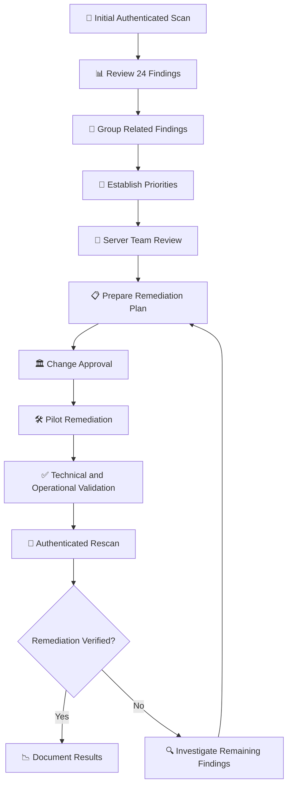

# 🔎 Post-Scan Review | Server Team

### 🌿🐇 Juniper Rabbit Labs

> **Meeting:** Initial Vulnerability Assessment — Findings Review  
> **Scenario:** Post-Initial Discovery Scan  
> **Format:** Simulated stakeholder meeting transcript  
> **Environment:** Juniper Rabbit Labs  
> **Role:** Katy — Vulnerability Management Analyst  
> **Stakeholder:** Mike — Server Team Manager  
> **Scan:** 01 — Initial Windows Server Baseline  
> **Objective:** Review pilot scan results, discuss operational impact and align on initial remediation priorities

---

## 📋 Meeting Context

The first authenticated vulnerability assessment of the Server Team pilot asset has been completed.

Before remediation begins, Vulnerability Management met with the Server Team to review the scan's operational impact, discuss the findings and determine which issues should move forward for pilot remediation.

The meeting focused on interpreting the initial vulnerability baseline, identifying related findings and developing a practical remediation strategy before requesting change approval.

> [!NOTE]
> **Initial Scan — 24 Reportable Findings**
>
> 🔴 **4 Critical**  
> 🟠 **8 High**  
> 🟡 **11 Medium**  
> 🟢 **1 Low**

The initial assessment established a baseline for measuring vulnerability reduction during subsequent remediation and validation activities.

---

## 💬 Stakeholder Discussion

### 👩‍💻 Katy — Vulnerability Management Analyst

> Hey Mike, I wanted to follow up now that the first authenticated scan is complete. Before we get into the findings, how did the server behave while the scan was running? Anything unusual from your side?

### 🖥️ Mike — Server Team Manager

> Nothing concerning. We kept an eye on the pilot while the assessment was running and didn't see any service interruption or performance issue that would make me uncomfortable continuing with the process.
>
> I'd still want us to monitor the next few scans, but the pilot went smoothly.

### 👩‍💻 Katy — Vulnerability Management Analyst

> Good. That's what I wanted to establish before we start talking about expanding anything.
>
> On the security side, Tenable reported 24 findings — 4 Critical, 8 High, 11 Medium and 1 Low.
>
> That number looks pretty dramatic at first, but there's some important context behind it.

### 🖥️ Mike — Server Team Manager

> I'm listening. Four Criticals definitely got my attention.

### 👩‍💻 Katy — Vulnerability Management Analyst

> Mine too. But the findings aren't necessarily 24 completely unrelated problems.
>
> A large cluster is coming from one piece of third-party software. Tenable identified Wireshark 2.2.1 on the server, which is an unsupported version. That single installation is generating multiple Critical, High and Medium findings.

### 🖥️ Mike — Server Team Manager

> So removing one obsolete application could clear a significant portion of the report?

### 👩‍💻 Katy — Vulnerability Management Analyst

> Exactly. That's why I don't want us prioritizing strictly by the number of red rows.
>
> The unsupported Wireshark installation gives us a concentrated remediation opportunity. If there's no business requirement for that version, removing it from the pilot would be one of my first recommendations.

### 🖥️ Mike — Server Team Manager

> There shouldn't be a reason for an unsupported packet analyzer to be sitting on a production server. I'll have the team validate that there isn't a dependency before we remove it.

### 👩‍💻 Katy — Vulnerability Management Analyst

> Perfect.
>
> There are also two Critical libcurl findings. I don't want to assume those disappear with Wireshark or treat them as the same issue without validating where the affected component is coming from.
>
> I'd like to keep those separately tracked while we work through the software remediation.

### 🖥️ Mike — Server Team Manager

> Agreed. We can check the software inventory and see what installed component is bringing that library onto the server.

### 👩‍💻 Katy — Vulnerability Management Analyst

> The scan also picked up some Windows configuration issues.
>
> SMB signing isn't currently required, and RDP isn't enforcing Network Level Authentication. Those aren't generating the Critical findings, but they're still configurations I'd want us to harden.

### 🖥️ Mike — Server Team Manager

> Those should be straightforward, but I'd still want them tested before we push configuration changes broadly.

### 👩‍💻 Katy — Vulnerability Management Analyst

> Same approach I'm recommending.
>
> We'll prepare the changes for this pilot first, validate each configuration locally and then perform an authenticated rescan.
>
> If Tenable no longer detects the issue, the authenticated checks complete successfully and the server remains stable, we'll have much stronger evidence for expanding the remediation.

### 🖥️ Mike — Server Team Manager

> What about the certificate findings?

### 👩‍💻 Katy — Vulnerability Management Analyst

> Tenable reported both an untrusted certificate and a self-signed certificate.
>
> I want to keep those documented, but I don't think they should distract us from the unsupported software and insecure server configurations in this first remediation cycle.
>
> We can review the certificate use separately to determine whether the certificates are expected for an internal service, whether clients actually trust them and whether replacement or another corrective action is necessary.

### 🖥️ Mike — Server Team Manager

> Makes sense. Anything else you're putting lower on the list?

### 👩‍💻 Katy — Vulnerability Management Analyst

> There's also a Low-severity ICMP timestamp disclosure finding.
>
> I'm not ignoring it, but compared with unsupported software producing Critical findings and the Windows authentication and protocol configurations we've identified, I'd put it later in the queue.
>
> We'll keep it documented and tracked rather than treating lower priority as automatic risk acceptance.

### 🖥️ Mike — Server Team Manager

> Okay. So what do you want my team to start with?

### 👩‍💻 Katy — Vulnerability Management Analyst

> First, let's validate the third-party software dependency and prepare the Wireshark removal for the pilot.
>
> After that, I'd like to work through the selected Windows configuration changes individually rather than changing everything at once. That way each verification scan can help us determine whether the remediation actually worked.
>
> I'll put together the remediation package with the proposed changes, validation steps, rollback considerations and the findings each change is intended to address.

### 🖥️ Mike — Server Team Manager

> Send it over. We'll review the pilot changes with the sysadmins before anything gets distributed more broadly.

### 👩‍💻 Katy — Vulnerability Management Analyst

> Perfect. Once the changes have gone through the appropriate approval process, we'll implement them in stages.
>
> After each remediation stage, I'll rescan and compare the results against this baseline.
>
> That should give us a clear record of what actually reduced the server's exposure instead of just assuming the change worked.

---

## 🎯 Findings Review

| Finding Area | Initial Assessment | Remediation Direction |
|---|---|---|
| **Unsupported Wireshark 2.2.1** | Multiple Critical, High and Medium findings | 🔴 Prioritize removal after dependency review |
| **libcurl Components** | 2 Critical findings | 🔎 Investigate affected components and track separately |
| **SMB Signing** | Signing not required | 🟠 Prepare configuration hardening |
| **RDP / NLA** | NLA not enforced | 🟠 Prepare configuration hardening |
| **Certificate Trust** | Self-signed and untrusted certificate findings | 🟡 Investigate certificate purpose and trust |
| **ICMP Timestamp** | Low-severity information disclosure | ⚪ Lower priority — continue tracking |

> [!IMPORTANT]
> **24 findings does not necessarily mean 24 independent remediation actions.**
>
> Multiple Tenable plugins may identify vulnerabilities associated with the same underlying software or configuration.
>
> Findings were grouped by likely remediation path before work was distributed to the Server Team.

### 🔍 Prioritization Considerations

Severity was an important factor in determining remediation priorities, but it was not the only consideration.

The review also considered:

- Whether multiple findings shared an underlying cause
- The availability of a practical remediation
- The potential operational impact of implementing a change
- Whether an affected application or service was required
- The need to investigate uncertain findings before taking action
- The ability to validate remediation through authenticated rescanning

The initial priority was to address the unsupported software while separately tracking unresolved Critical findings and preparing Windows configuration hardening.

---

## 🤝 Meeting Outcome

The initial authenticated vulnerability scan completed without an observed operational issue on the pilot server.

The Server Team reported no noticeable service interruption or performance degradation during the assessment.

Vulnerability Management and the Server Team agreed to move forward with a staged remediation strategy rather than attempting to resolve all findings simultaneously.

The meeting established preliminary remediation priorities. Implementation remained subject to dependency validation, technical review and the appropriate change authorization.

### 📌 Agreed Next Steps

- [ ] Validate whether Wireshark 2.2.1 has a legitimate server dependency
- [ ] Prepare third-party software remediation for pilot testing
- [ ] Investigate the source of the two Critical libcurl findings
- [ ] Prepare selected Windows configuration hardening changes
- [ ] Document proposed validation and rollback procedures
- [ ] Submit pilot remediation changes for appropriate approval
- [ ] Implement approved changes in controlled stages
- [ ] Validate each remediation on the pilot server
- [ ] Perform authenticated Tenable rescans following remediation
- [ ] Compare results against the Scan 01 baseline
- [ ] Review pilot results before broader deployment

---

## 🔄 Remediation Planning Workflow

---

## 🧠 Skills Demonstrated

`Vulnerability Management` · `Tenable` · `Authenticated Scanning` · `Risk-Based Prioritization` · `Stakeholder Coordination` · `Remediation Planning` · `Asset Management` · `Security Operations`

---

## 💡 Analyst Takeaway

The initial assessment demonstrated why vulnerability counts alone don't determine remediation priority.

Although 24 reportable findings were identified, many were concentrated around the same obsolete third-party application. Grouping findings by underlying cause and remediation path created a more actionable plan for the Server Team.

The review also reinforced the importance of investigating uncertain findings, validating software dependencies and accounting for operational impact before implementing security changes.

> **A vulnerability scan identifies potential security exposure. The investigation determines what needs to be fixed, why it matters and how to address it responsibly.**

---

## ➡️ Next Phase

With the initial findings reviewed and remediation priorities established, the Vulnerability Management team can prepare the proposed changes for technical review and change authorization.

The next phase will focus on evaluating operational risks, documenting rollback procedures and obtaining approval before pilot remediation begins.

**Next Phase → `Change Advisory Board — Pilot Remediation Review` 🏛️**

---

*This project uses a simulated organizational environment to demonstrate the implementation of a vulnerability management program. Names, conversations and organizational scenarios presented in this portfolio artifact are fictional and created for educational purposes.*
