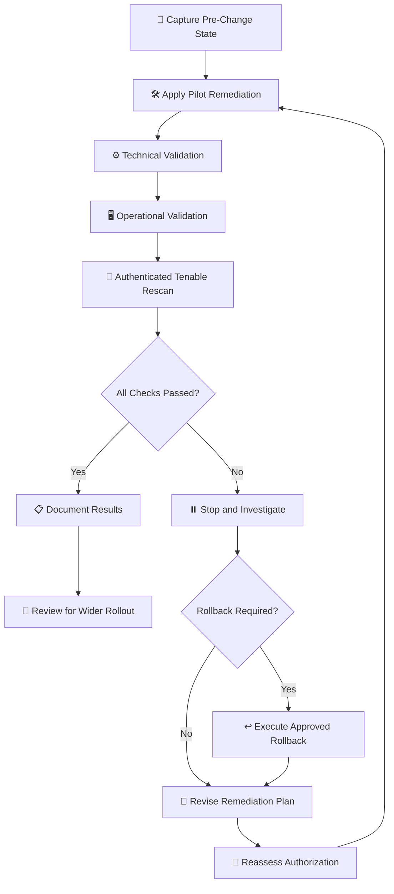

# 🏛️ Change Advisory Board | Pilot Remediation Review

### 🌿🐇 Juniper Rabbit Labs

> **Meeting:** Change Advisory Board — Vulnerability Remediation Review  
> **Scenario:** Review and Approval of Pilot Vulnerability Remediation  
> **Format:** Simulated Change Advisory Board meeting transcript  
> **Environment:** Juniper Rabbit Labs  
> **Change Type:** Security Remediation / Server Configuration  
> **CAB Facilitator:** Jennifer  
> **Vulnerability Management Analyst:** Katy  
> **Server Team Manager:** Mike  
> **Lead Systems Engineer:** Marcus  
> **Objective:** Review proposed pilot remediation changes, operational risks, testing requirements and rollback procedures before implementation

---

## 📋 Change Request

The Vulnerability Management team is requesting approval to begin controlled pilot remediation of findings identified during the initial authenticated assessment of the Windows Server environment.

The proposed approach prioritizes high-risk vulnerabilities while limiting operational impact through staged implementation, configuration validation and authenticated rescanning.

### 🛠️ Proposed Pilot Changes

| Change | Reason | Initial Approach |
|---|---|---|
| Remove unsupported Wireshark 2.2.1 | Multiple Critical, High and Medium findings | Remove from pilot server after dependency validation |
| Remove unnecessary Guest privileges | Reduce excessive administrative access | Remove privileged membership and disable account |
| Require SMB signing | SMB signing currently not required | Enable and validate required SMB signing |
| Require RDP Network Level Authentication | NLA currently not enforced | Require NLA and validate RDP connectivity |
| Harden legacy authentication | Weak LAN Manager configuration identified | Require stronger authentication after compatibility review |

> [!IMPORTANT]
> **Pilot Scope Only**
>
> The proposed changes apply only to the designated pilot server. Broader deployment requires successful testing, validation and any additional change authorization required by organizational procedures.

---

## 📊 Initial Vulnerability Baseline

The initial authenticated Tenable assessment identified **24 reportable vulnerabilities** on the pilot server.

| Severity | Initial Findings |
|---|---:|
| 🔴 Critical | 4 |
| 🟠 High | 8 |
| 🟡 Medium | 11 |
| 🟢 Low | 1 |
| **Total** | **24** |

A significant portion of the findings was associated with unsupported third-party software, including Wireshark 2.2.1.

Additional findings involved Windows authentication and network security configurations.

The baseline provided a measurable starting point for evaluating the effectiveness of the proposed remediation activities.

---

## 💬 CAB Discussion

### 👩‍💼 Jennifer — CAB Facilitator

> Thanks, everyone. We're reviewing the vulnerability remediation change for the Server Team pilot today.
>
> Katy, can you start with what we're changing and why this needs to come through CAB?

### 👩‍💻 Katy — Vulnerability Management Analyst

> Absolutely.
>
> Our initial authenticated Tenable assessment identified 24 reportable vulnerabilities on the pilot server — 4 Critical, 8 High, 11 Medium and 1 Low.
>
> A large portion of those findings trace back to an unsupported Wireshark 2.2.1 installation. We also identified server configuration issues including SMB signing not being required and RDP operating without Network Level Authentication.
>
> Rather than making all of the changes at once or distributing them broadly, I'm proposing a controlled remediation on the pilot server first.

### 👩‍💼 Jennifer

> What's the risk if we leave the current configuration as-is?

### 👩‍💻 Katy

> The most concentrated risk is the unsupported software.
>
> Wireshark 2.2.1 is generating findings across multiple severity levels, including Critical findings. Because the version is no longer supported, we can't rely on normal vendor security updates to maintain it.
>
> The configuration findings are different. SMB signing and NLA are security controls rather than obsolete applications. Restoring those controls reduces exposure without requiring us to replace the operating system or application stack.

### 🧑‍💻 Marcus — Lead Systems Engineer

> Removing Wireshark doesn't concern me much if we've confirmed nothing depends on it.
>
> I'm more interested in the configuration changes. What happens if requiring SMB signing affects an older client or service that expects the current configuration?

### 👩‍💻 Katy

> That's exactly why I'm proposing the pilot rather than a broad deployment.
>
> We'll capture the current configuration before making the change, apply it to the pilot, validate SMB connectivity and monitor for unexpected behavior.
>
> We won't use the absence of an error message as proof that the remediation worked. We'll validate the configuration locally and then use the follow-up Tenable scan as independent verification.

### 🧑‍💻 Marcus

> And what's the rollback plan?

### 👩‍💻 Katy

> Each configuration change will have its original value documented before modification.
>
> For registry-backed settings, we'll maintain the previous value and a corresponding rollback command. For the SMB and RDP changes, we'll capture the existing configuration before applying the secure setting.
>
> If the pilot produces a service or connectivity issue, the affected change can be reverted where technically feasible without rolling back unrelated remediations.

### 🧑‍💻 Marcus

> That's important. I'd rather have individual rollback points than one large script that reverses everything.

### 👩‍💻 Katy

> Same here.
>
> I'm deliberately separating the changes so we can tell which remediation caused an issue if something behaves unexpectedly.

### 🖥️ Mike — Server Team Manager

> From the operations side, the initial vulnerability scan didn't cause any noticeable stability problems on the pilot.
>
> My concern now is avoiding a situation where we harden five things simultaneously, restart the server and then have no idea which change caused a problem.

### 👩‍💻 Katy

> Agreed.
>
> My proposed sequence is staged.
>
> First we'll handle the unsupported third-party software. Then we'll move through the server configuration changes in controlled groups, validating the system between stages.
>
> Each stage gets its own verification scan so we can compare it against the original baseline.

### 👩‍💼 Jennifer

> What about patching? Is that included in this change request?

### 👩‍💻 Katy

> I want to keep that slightly separate.
>
> During creation of the vulnerable server, Windows Update was paused using the maximum pause period available in the current interface. Our Tenable compliance results still showed the underlying automatic-update policy as enabled.
>
> So I don't want the CAB record to describe this as "re-enabling Automatic Updates" when that isn't what our evidence shows.
>
> We'll resume update activity and apply applicable updates during remediation, but we'll document the actual state rather than treating it as a policy change that didn't occur.

### 🧑‍💻 Marcus

> I like that distinction. A paused update schedule and a disabled update policy aren't the same change.

### 👩‍💼 Jennifer

> What about the two Critical libcurl findings from the scan? Are those part of this request?

### 👩‍💻 Katy

> They're being tracked, but I'm not proposing a standalone libcurl change until we've established which installed component is responsible for them.
>
> I don't want us changing or removing a shared library based solely on the plugin title.
>
> If removing the unsupported Wireshark installation also removes the affected component, the rescan will show us that. If the findings remain, we'll investigate the dependency and create a separate remediation action.

### 🧑‍💻 Marcus

> That's the approach I'd prefer. Don't manually replace a library until we know what owns it.

### 🖥️ Mike

> Agreed.

### 👩‍💼 Jennifer

> Let's talk validation. What tells us this pilot succeeded?

### 👩‍💻 Katy

> Three things.
>
> First, **technical validation** — the expected configuration is present after the change.
>
> Second, **operational validation** — the server remains stable and the Server Team confirms the required services and connectivity still work.
>
> Third, **security validation** — an authenticated Tenable rescan confirms that the targeted findings are no longer detected.
>
> I want all three before recommending broader deployment.

### 👩‍💼 Jennifer

> And if one fails?

### 👩‍💻 Katy

> We stop that remediation path, roll back the affected change if necessary, document what happened and reassess it before attempting wider deployment.
>
> A successful script execution by itself won't count as a successful remediation.

### 🧑‍💻 Marcus

> That's my main concern addressed.
>
> These are mostly manageable changes individually. The risk comes from pushing them together without understanding dependencies. Pilot first, separate rollback points and validation between stages makes sense from engineering.

### 🖥️ Mike

> Server Team is comfortable supporting that. We'll monitor the pilot during the changes and flag anything abnormal before Katy runs the verification scans.

### 👩‍💼 Jennifer

> Okay. I'm approving the pilot with conditions.
>
> Keep the scope to the designated server, document the pre-change state, maintain a rollback method for each configuration change and complete technical and operational validation before anything moves toward wider deployment.
>
> Any unexpected impact comes back through the change process before expansion.

### 👩‍💻 Katy

> Works for me. I'll document the remediation evidence and scan results as we move through each stage.

---

## 🤝 CAB Decision

> [!IMPORTANT]
> **PILOT CHANGE: APPROVED WITH CONDITIONS**
>
> The CAB approved controlled remediation testing on the designated pilot server.
>
> Approval does **not** authorize organization-wide deployment.

### 📌 Approval Conditions

The following requirements were established as conditions of approval. They represent required activities rather than completed remediation work.

- [ ] Limit initial changes to the designated pilot server
- [ ] Capture relevant pre-change configurations and system state
- [ ] Document individual rollback procedures
- [ ] Validate server functionality after each remediation stage
- [ ] Perform authenticated Tenable verification scans
- [ ] Investigate unresolved Critical findings before broader rollout
- [ ] Return unexpected operational impact to CAB for review
- [ ] Document remediation results before requesting expanded deployment

---

## 🔄 Approved Change Path

---

## 🛡️ Rollback Strategy

Configuration changes will be treated as **independent change units**.

Rather than relying on a single all-or-nothing rollback script, the original configuration for each affected control will be documented so individual changes can be reversed when technically feasible.

### Rollback Considerations

| Change Type | Rollback Approach |
|---|---|
| Unsupported Software Removal | Document dependencies and retain an approved recovery or replacement method |
| Guest Account Hardening | Record original account status and group membership |
| SMB Signing | Capture original SMB server settings and verify connectivity after any reversal |
| RDP NLA | Record original registry configuration and validate remote administration access |
| LAN Manager Authentication | Document original authentication policy and review compatibility before reversal |

Rollback is not automatically equivalent to restoring a secure or trusted state. Reversing a security control may reintroduce the original vulnerability and should be performed only when operationally justified and authorized.

Software removal may also require reinstalling an approved version or restoring from a known-good backup rather than simply reversing a configuration value.

This approach helps limit the operational impact of remediation and makes it easier to identify which change caused an unexpected issue.

---

## 🔍 Remediation Validation Criteria

The pilot will be considered successful only when the following requirements are satisfied.

| Validation Area | Success Criteria |
|---|---|
| **Technical** | Required configuration changes are confirmed locally |
| **Operational** | Server functionality and required connectivity remain acceptable |
| **Security** | Targeted vulnerabilities are no longer detected during authenticated rescanning |
| **Scan Quality** | Authentication succeeds and relevant vulnerability checks complete |
| **Documentation** | Changes, evidence and results are recorded |
| **Residual Risk** | Remaining findings are investigated and tracked for remediation or formal risk disposition |

A finding disappearing from a scan does not automatically prove that the underlying vulnerability was eliminated. Scan coverage, authentication success and detection conditions must also be considered.

---

## 🧠 Skills Demonstrated

`Change Management` · `Vulnerability Management` · `Tenable` · `Risk Assessment` · `Stakeholder Coordination` · `Remediation Planning` · `Rollback Strategy` · `Security Validation`

---

## 💡 Key Takeaway

Vulnerability remediation is not simply a matter of applying security changes and assuming the system is safer.

Even beneficial security controls can create compatibility or availability problems when implemented without understanding system dependencies.

The CAB process provides an opportunity to evaluate those risks before implementation.

In this scenario, the proposed remediation strategy balanced three objectives:

**Reduce security exposure → Preserve operational stability → Verify remediation effectiveness**

The pilot approach established a controlled path for implementing security improvements while maintaining accountability, documented rollback procedures and measurable validation criteria.

> **A successful remediation requires more than a completed change. It requires evidence that the vulnerability was addressed without introducing unacceptable operational risk.**

---

## ⏭️ Next Phase

With conditional CAB approval obtained, the Vulnerability Management team can begin preparing the authorized pilot remediation activities.

The next phase will document the implementation of approved changes, local configuration validation, operational testing and authenticated Tenable rescanning.

**Next Phase → `Pilot Remediation → Validation → Authenticated Rescan`**

---

*This project uses a simulated organizational environment to demonstrate the implementation of a vulnerability management program. Names, conversations and organizational scenarios presented in this portfolio artifact are fictional and created for educational purposes.*
